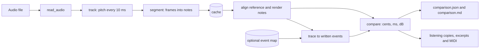

# How it works

`compare.py` runs the same analysis on both files and then compares the two
note lists.

## 1. Reading audio

Files are read with [soundfile](https://github.com/bastibe/python-soundfile)
(libsndfile), so WAV in any PCM or float format, FLAC and OGG Vorbis all work.
Samples are scaled to about −1 to 1. Stereo is mixed to mono for pitch tracking. Peak and RMS are
measured on all channels within the selected range.

## 2. Pitch tracking

The tracker uses the **YIN** method. Every **10 ms** it examines a
**40 ms** window and looks for the repeating period of the waveform between
about **120 Hz and 2400 Hz**. Then:

- Frames quieter than 0.8% of the clip's peak are treated as silence.
- Frames with confidence below 0.70 are treated as unpitched.
- The period is refined between samples, so the estimate is finer than one sample.

## 3. Segmenting into notes

Consecutive pitched frames form a note. A note ends when a frame is unpitched,
or when the pitch moves more than **65 cents** away from the median of the
previous five frames. Pitch stability and attack evidence are then weighed
together:

- **Voicing gaps are bridged.** Up to **three** unpitched frames (30 ms) are
  joined into the surrounding note when they are audible but not periodic,
  such as a breath or a tracker dropout, and the pitch on both sides agrees
  within 65 cents. Silent frames, below the level gate, always end a note.
- **Reattacks split a note.** A stable note is split where its level dips at
  least **6 dB** below the loudest frame of the previous 100 ms and rises at
  least 6 dB within the next 50 ms, while the tone stays clearly pitched
  (confidence **0.85** or more). This catches a slurred repeated note. Breath
  and noise lower the confidence, and vibrato or a slow swell does not dip
  that far, so they do not split a note.

Notes shorter than **55 ms** are not used, but they are kept in the JSON as
`candidates` with the reason. Each note records why it starts
(`start_reason`) and any bridged `gaps`. Each note's pitch is the median of
its pitched frames, so vibrato averages out.

## 4. Caching

The analysis (frames and notes) is stored as JSON in the cache folder. The
file is named by a SHA-256 hash of the analysis version, the requested time
range and the audio file's bytes. See [Caching](usage.md#caching).

## 5. Matching notes

The two note lists are aligned with dynamic programming, much like an edit
distance:

- Pairing two notes is free if their pitches are within 35 cents. The cost
  then rises by 1 per 100 cents, up to 1.75. A difference in duration adds up
  to 0.35.
- A pair more than 300 cents apart is excluded. Leaving a note unmatched on either side costs 1.

The report describes detected events. A missed detection, an ornament, or a written
note error can all produce an unmatched event. Audio is never stretched.

## 6. Measuring

- **Offset:** the start difference of the first matched pair whose pitches
  are within 60 cents. It is subtracted from every attack difference.
- **Pitch:** `(render − reference) × 100` cents.
- **Duration:** the difference in note length, in ms.
- **Level:** `20·log10(render note RMS / reference note RMS)` plus the gain
  that matches the two clips' overall RMS.
- **Note match score:** [mir_eval](https://github.com/mir-evaluation/mir_eval)'s
  `transcription.precision_recall_f1_overlap`, with onsets within 50 ms and
  pitch within 50 cents after removing the offset. It is calculated a second
  time with note ends required within 20%.

## 7. Listening copies and MIDI

- [pyloudnorm](https://github.com/csteinmetz1/pyloudnorm) measures each clip's
  integrated loudness (ITU-R BS.1770). The render copy gets the gain that makes
  the two equal. Clips too short to measure (under 0.4 s) use the RMS gain instead.
- With `--excerpts`, each flagged event in the report gets a reference clip
  and a render clip. Both run from the start of the previous matched pair to
  the end of the next one, plus 0.25 s, so they cover the same notes. The
  render clip gets the listening copy's gain.
- With `--midi`, [pretty_midi](https://github.com/craffel/pretty-midi) writes
  the reference's detected notes to a MIDI file. MIDI velocity is 100 for the
  loudest note, minus 2 per dB quieter, with a minimum of 20. Every
  detected note is written unless you ask for a filter
  (`--midi-min-confidence`, `--midi-skip-out-of-range`). The report counts
  the notes left out and the JSON lists each one with its reason. Candidates
  shorter than 55 ms are never written.

## 8. Suspect pitches

Detected notes are checked for likely octave errors and out-of-range pitches.
Each finding is a **review flag** with its reason and the pitch evidence. No
note is ever removed or changed.

| Flag | When |
|---|---|
| `octave_leap` | A note is an octave (or two), within 50 cents, from both of its neighbours on the same side, in the same direction. |
| `octave_counterpart` | An unmatched reference event and an extra render event are next to each other, within 100 ms of the same place and an octave apart. Alignment never pairs notes more than 300 cents apart, so an octave error shows up this way. |
| `octave_written` | With an event map: a note has no written event at its pitch, but there is one an octave away within 100 ms. |
| `instrument_range` | With `--instrument-range`: a note is more than 50 cents outside the range. |
| `tracker_limit` | A note is within a semitone of the tracker's 120 Hz or 2400 Hz limit, where octave errors are more likely. |

## 9. Tracing events to the score

With `--event-map`, each detected render note is paired with a written note
using mir_eval's `transcription.match_notes`: attacks within **100 ms** and
pitch within **50 cents**, with note ends ignored. Each pairing is one-to-one.

- A row with a render detection takes that detection's written note, if any.
  A matched pair whose render note has no written note is flagged for review.
- A reference note with no render detection looks for an unused written note
  at the same pitch (within 50 cents) between the neighbouring render
  detections. If there is one, the note is written but was not detected in the
  render. Otherwise there is no mapped written event for it.
- Written notes still unused become `undetected written event` rows.

The same pairing drives the [detector check](report.md#detector-check). A
matched detection counts as a boundary error when its attack is more than
**30 ms** or its end more than **100 ms** from the written note.
