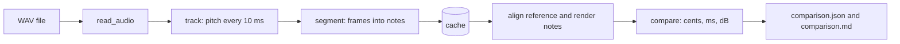

# How it works

`compare.py` runs the same analysis on both files and then compares the two
note lists.

## 1. Reading audio

Unsigned 8-bit, signed integer and floating-point WAV files are scaled to
about −1 to 1. Stereo is mixed to mono for pitch tracking. Peak and RMS are
measured on all channels within the selected range.

## 2. Pitch tracking

The tracker uses the **YIN** method. Every **10 ms** it examines a
**40 ms** window and looks for the repeating period of the waveform between
about **120 Hz and 2400 Hz**. Then:

- Frames quieter than 0.8% of the clip's peak are treated as silence.
- Frames with confidence below 0.70 are treated as unpitched.
- The period is refined between samples, so the estimate is finer than one sample.

## 3. Segmenting into notes

Consecutive pitched frames form a note. A note ends when a frame is unpitched,
or when the pitch moves more than **65 cents** away from the median of the
previous five frames. Notes shorter than **55 ms** are discarded. Each note's
pitch is the median of its frames, so vibrato averages out.

## 4. Caching

The analysis (frames and notes) is stored as JSON in the cache folder. The
file is named by a SHA-256 hash of the analysis version, the requested time
range and the audio file's bytes. See [Caching](usage.md#caching).

## 5. Matching notes

The two note lists are aligned with dynamic programming, much like an edit
distance:

- Pairing two notes is free if their pitches are within 35 cents. The cost
  then rises by 1 per 100 cents, up to 1.75. A difference in duration adds up
  to 0.35.
- Leaving a note unmatched on either side costs 1.

So a wrong or missing note shows up as an unmatched or extra event, and the
notes that follow it stay in sync. Audio is never stretched.

## 6. Measuring

- **Offset:** the start difference of the first matched pair whose pitches
  are within 60 cents. It is subtracted from every attack difference.
- **Pitch:** `(render − reference) × 100` cents.
- **Duration:** the difference in note length, in ms.
- **Level:** `20·log10(render note RMS / reference note RMS)` plus the gain
  that matches the two clips' overall RMS.
